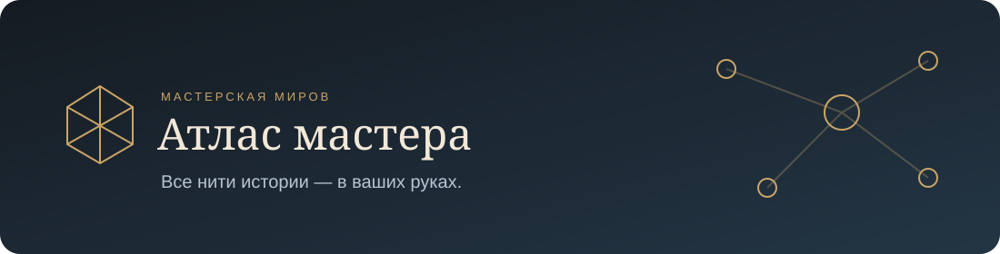

  

<strong>Windows 10 / 11 · x64 · Локальное хранение · Без регистрации</strong>

  <a href="https://github.com/valentinbulatsky-hash/atlas-master/releases/latest"><strong>Скачать приложение</strong></a>
  &nbsp;•&nbsp;
  <a href="CHANGELOG.md">Журнал изменений</a>
  &nbsp;•&nbsp;
  <a href="desktop/README.md">Установка и данные</a>

**Атлас мастера** — рабочее пространство для мастера D&D. Собирайте мир кампании из статей, персонажей и карт, связывайте материалы на досках и записывайте события игровых сессий. Кампании, изображения и PDF хранятся на вашем компьютере и доступны без интернета.

## Начните свою кампанию

1. Откройте [последний релиз](https://github.com/valentinbulatsky-hash/atlas-master/releases/latest) и скачайте **AtlasMaster-0.1.2-Windows-x64-Setup.zip**.
2. Распакуйте архив и запустите **AtlasMaster-0.1.2-x64-Setup.exe**. Выберите папку установки.
3. Откройте «Атлас мастера» через ярлык. Создайте кампанию или загрузите существующую из файла `.atlas.json`.

В архиве находится один установщик со всеми необходимыми компонентами. Дополнительные программы для установки не нужны.

## Что нового в 0.1.2

| Функция | Что она даёт мастеру |
| --- | --- |
| **Обратные ссылки** | Раскрывающийся список материалов, в которых упоминается открытая запись. Видны тип источника и каталог; нажатие открывает источник. Сессии в список не входят. |
| **Расширенный поиск** | Подсказки при вводе в боковой панели. Enter или лупа открывает все совпадения текущей кампании с фильтрами по типу и каталогу, включая подкаталоги. |
| **Сортировка результатов** | По совпадению, дате добавления, дате изменения или названию. |
| **Защита от повторов** | Предупреждение при попытке создать, переименовать или переместить материал с совпадающим названием того же типа в том же каталоге. Игровые персонажи и NPC учитываются отдельно. |
| **Журнал сессий** | Записи с форматированным текстом, датой, временем и участниками из игровых персонажей кампании. Собственный поиск журнала; записи входят в экспорт кампании. |
| **Навигация по уровням** | Нажмите название кампании, раздела или каталога сверху страницы, чтобы перейти на этот уровень. Несохранённые правки защищены предупреждением. |

Журнал находится **на главной странице кампании и в боковом меню**. Поиск библиотеки не включает сессии и материалы других кампаний.

[Все изменения по версиям →](CHANGELOG.md)

## Ваш мир в одном приложении

| Раздел | Возможности |
| --- | --- |
| **Кампании** | Отдельные миры, главная страница, вложенные каталоги и недавние материалы. |
| **Статьи** | Форматирование, изображения, внутренние и внешние ссылки. В разделе материалов показываются только статьи. |
| **Персонажи** | Раздельные списки игровых персонажей и NPC; портреты, описания, роли, мотивация и заметки мастера. |
| **Листы персонажей** | Прикрепление PDF, просмотр страниц, увеличение и открытие оригинала. |
| **Карты мира** | Изображение карты, масштабирование, перемещение, метки со ссылками на материалы и текстовое описание. |
| **Доски связей** | Блоки разных форм и цветов, краткие описания, ссылки и просмотр содержимого. Размеры меняются перетаскиванием. |
| **Связи на доске** | Типы и цвета линий, указатели на обоих концах, положение подписи, привязка к сетке и магнитное выравнивание. |
| **Чтение и редактирование** | Материал открывается для чтения; редактирование включается отдельно. Изменения сохраняются кнопкой «Сохранить». |
| **Оформление** | Светлая и тёмная темы, стандартные и собственные фоны кампаний с предварительным просмотром. |
| **Перенос кампаний** | Экспорт и импорт `.atlas.json` вместе с вложениями и внутренними ссылками. Можно передать кампанию другому мастеру. |
| **Настройки** | Тема, масштаб интерфейса, полный экран, папка данных, команды работы с текстом и сведения о приложении. |

## Кампании остаются с вами

Данные сохраняются в профиле Windows: `%APPDATA%\AtlasMaster\data`. Установка обновления заменяет программу и сохраняет кампании. Каждый мастер работает со своей локальной коллекцией.

Перед обновлением можно сохранить кампании в `.atlas.json`. Для полной резервной копии закройте приложение и скопируйте папку данных вместе с вложениями. Автоматические снимки при запуске включают только базу.

Личные кампании и персонажи автора в установщик не включены. Облачной синхронизации и совместного редактирования пока нет; кампании передаются файлами.

[Подробности хранения, переноса и ограничений →](desktop/README.md)

## Выпуски и обратная связь

- [Последняя версия и установщик](https://github.com/valentinbulatsky-hash/atlas-master/releases/latest)
- [История изменений](CHANGELOG.md)
- [Сообщить об ошибке или предложить функцию](https://github.com/valentinbulatsky-hash/atlas-master/issues)

Версия 0.1.2 прошла сборку, проверку TypeScript, 12 автоматических тестов и проверки интерфейса в Windows. Установщик пока не подписан цифровой подписью издателя.

Исходный код находится в репозитории; пользовательские архивы релизов содержат только установщик.
